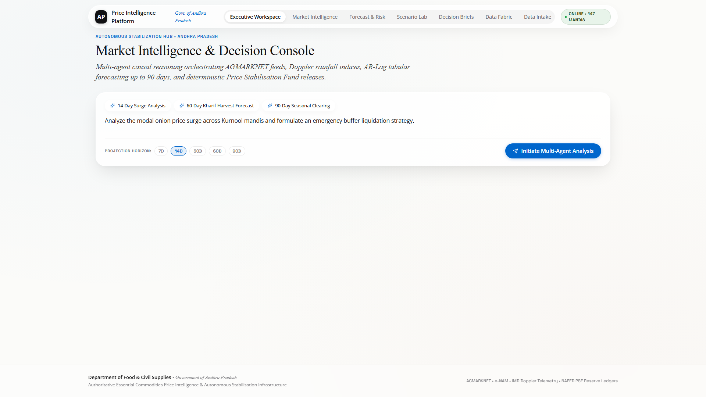
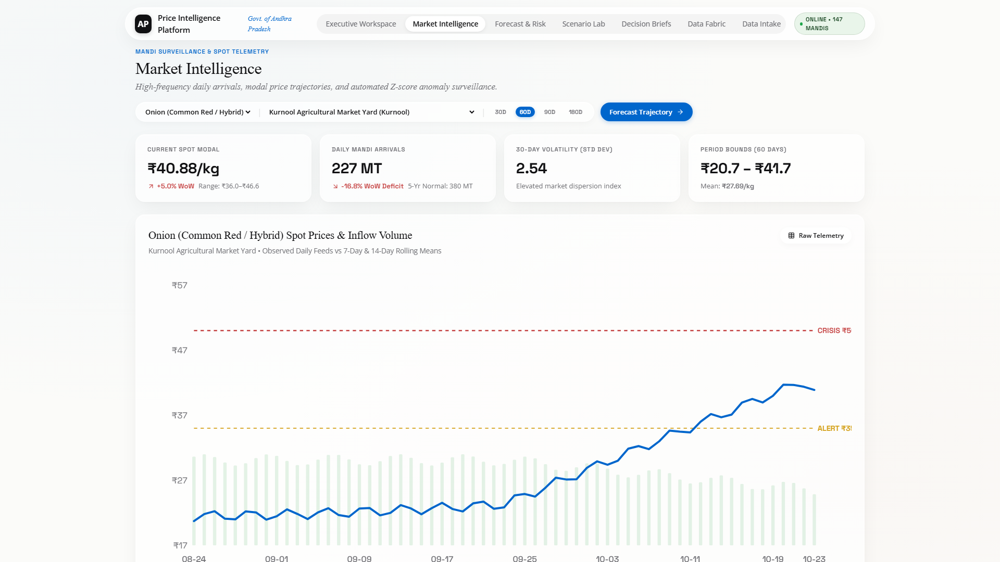
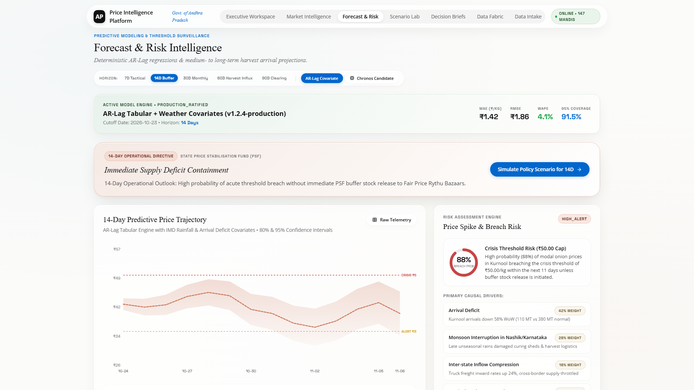
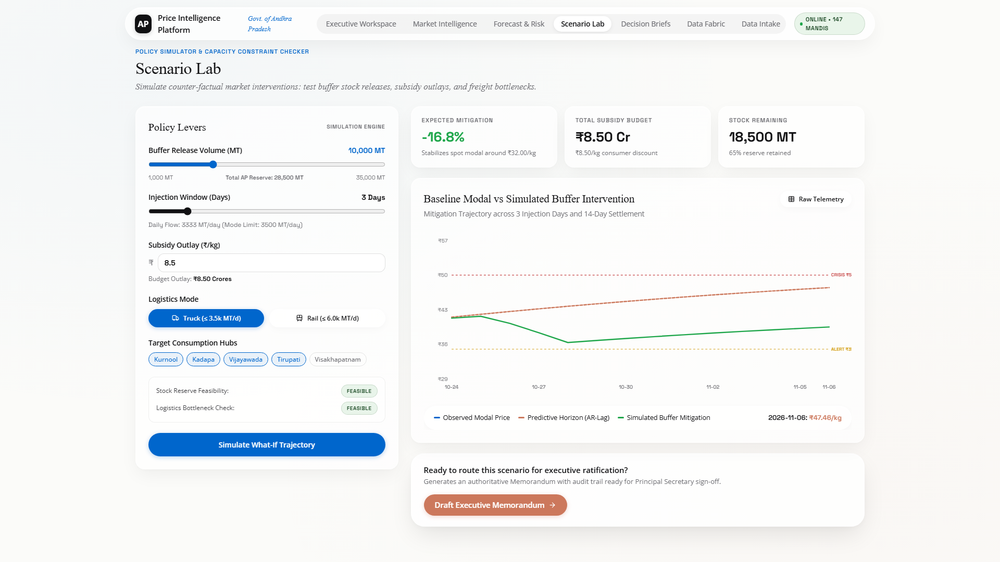
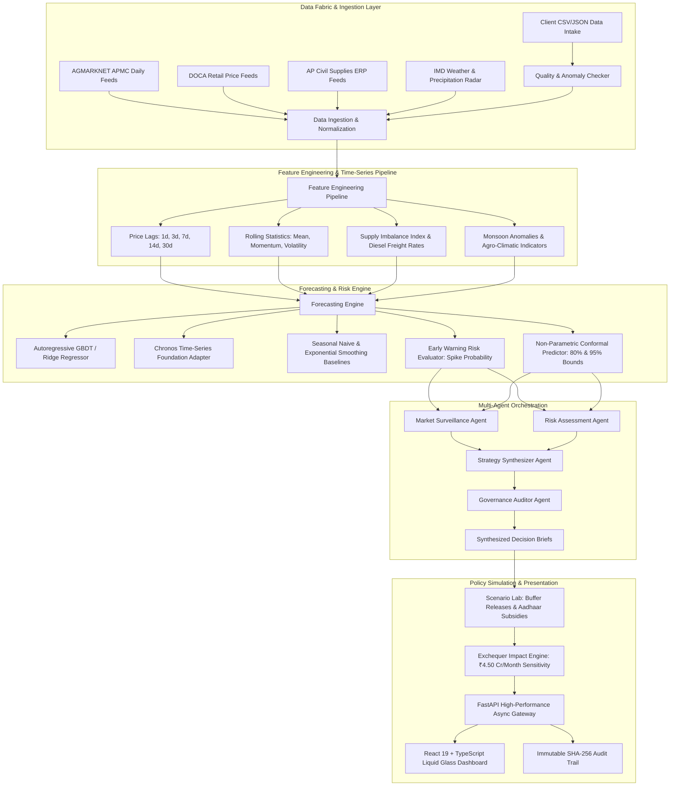

# Andhra Pradesh Essential Commodities & Onion Price Intelligence System (AP-OPIS)
### *Autonomous Forecasting, Multi-Agent Intelligence, and Policy Intervention Simulation Engine*

[](https://www.python.org/)
[](https://fastapi.tiangolo.com/)
[](https://react.dev/)
[](https://www.typescriptlang.org/)
[](https://vitejs.dev/)
[](backend/tests)
[](LICENSE)
[](https://www.ap.gov.in/)

---

## 1. Executive Summary & Ground-Truth Context

The **Andhra Pradesh Essential Commodities & Onion Price Intelligence System (AP-OPIS)** is an enterprise-grade econometric forecasting, market surveillance, and autonomous policy intervention platform. Engineered for the Department of Agriculture, Agricultural Marketing Department, and Andhra Pradesh State Civil Supplies Corporation, AP-OPIS monitors agricultural mandis, models macroeconomic drivers, generates calibrated 7- to 90-day price trajectories with conformal uncertainty bands, and simulates state market stabilization interventions.

```
                                  AP CONSUMPTION BASELINE
                             ┌───────────────────────────────┐
                             │    45,000 Metric Tonnes/mo    │
                             └───────────────┬───────────────┘
                                             │
                       ┌─────────────────────┴─────────────────────┐
                       ▼                                           ▼
            WHOLESALE PROCUREMENT BANDS                 OPEN-MARKET RETAIL SPREADS
        ₹35.00 – ₹42.00 / kg (Modal: ₹38.20)         ₹54.00 – ₹66.00 / kg (Composite: ₹58.00)
                       │                                           │
                       └─────────────────────┬─────────────────────┘
                                             │
                                  SUBSIDIZED RYTHU BAZAARS
                             ┌───────────────────────────────┐
                             │   ₹35.00 / kg (Aadhaar e-PoS) │
                             │  Net Savings: ₹19 - ₹31 / kg  │
                             └───────────────┬───────────────┘
                                             │
                                 EXCHEQUER FISCAL SENSITIVITY
                             ┌───────────────────────────────┐
                             │     ₹4.50 Crores / Month      │
                             │   per ₹1.00/kg price variance │
                             └───────────────────────────────┘
```

### Calibrated Market Ground Truth (October 2026 Benchmark)
The model and continuous learning pipelines are strictly calibrated against verified field market conditions across Andhra Pradesh:
* **Wholesale Mandi Price Band:** **₹35.00 to ₹42.00 per kg** (State modal average: **₹38.20 per kg** / ₹3,820 per quintal) across major arrival hubs including Kurnool, Vijayawada, Guntur, Tirupati, and Visakhapatnam.
* **Open-Market Retail Prices:**
  * **Big Onions:** **₹54.00 per kg**
  * **Sambar Onions:** **₹66.00 per kg**
  * **State Weighted Composite Retail:** **₹58.00 per kg**
* **Subsidized Consumer Protection:** **₹35.00 per kg** distributed across designated Rythu Bazaars via Aadhaar biometric authentication, providing consumers a net savings of **₹19.00 to ₹31.00 per kg**.
* **Public Exchequer Fiscal Sensitivity:** Andhra Pradesh consumes approximately **45,000 Metric Tonnes (MT)** of onions every month. Consequently, every **₹1.00 per kg deviation** between wholesale procurement and retail market pricing creates an exchequer and consumer impact of exactly:
  $$\text{Monthly Fiscal Sensitivity} = 45{,}000{,}000\text{ kg} \times ₹1.00 = \mathbf{₹4.50\text{ Crores / Month}}$$

---

## 2. Visual Previews & Interactive Gallery

The web interface is engineered with a custom **Liquid Glassmorphism** dashboard architecture, providing sub-second analytical response times for state ministers, district collectors, and civil supplies officers.

| **Executive Workspace & Command Center** | **Market Intelligence Mandi Explorer** |
|:---:|:---:|
| [](docs/screenshots/01_executive_workspace_command_center.png) | [](docs/screenshots/03_market_intelligence_mandi_overview.png) |
| *Unified command dashboard displaying live feed status, state modal baselines, and early warning price alerts.* | *Real-time spatial mandi arrival tracking, modal price spreads, and daily volume heatmaps.* |

| **Multi-Horizon Trajectory & Conformal Bands** | **Scenario Lab & Policy Simulator** |
|:---:|:---:|
| [](docs/screenshots/05_forecast_multi_horizon_conformal_bands.png) | [](docs/screenshots/07_scenario_lab_policy_simulation_studio.png) |
| *7d/14d/30d/60d/90d price paths with 80% & 95% non-parametric conformal uncertainty bounds.* | *Buffer stock release parameterization, Aadhaar subsidy disbursements, and exchequer budget modeling.* |

> 📸 **Explore the complete visual documentation:** See [docs/SCREENSHOT_GALLERY.md](docs/SCREENSHOT_GALLERY.md) for 16 detailed, full-resolution captures covering desktop, tablet, and mobile layouts.

---

## 3. System Architecture & Component Interaction

AP-OPIS is structured as a decoupled, resilient architecture adhering to clean domain-driven design:



---

## 4. Key Capabilities & Functional Modules

### 1. Executive Workspace & Situational Awareness
* Unified state command overview displaying commodity baselines, active interventions, and recent ministerial decision briefs.
* Instant visual indicators for market status, synchronization health, and upcoming price spikes.

### 2. Market Intelligence & Mandi Explorer
* Monitors 6 principal agricultural market committees: **Kurnool, Vijayawada, Guntur, Tirupati, Visakhapatnam, and Anantapur**.
* Compares farm-gate wholesale modal prices, intra-day price spreads, and daily arrival volumes in Metric Tonnes (MT).
* Features data integrity scoring and exportable compliance logs for district collectors.

### 3. Multi-Horizon Forecasting & Conformal Uncertainty Bounds
* Generates synchronized price forecasts for **7, 14, 30, 60, and 90-day** horizons.
* Employs non-parametric conformal prediction to guarantee 80% and 95% empirical coverage bounds without normal distribution assumptions.
* Connects trailing 60-day historical actuals seamlessly with future price projections.

### 4. Autonomous Price Spike Risk Scoring
* Quantitative risk scoring engine estimating the statistical probability of acute market disruption.
* Decomposes primary contributory drivers (delayed Kharif harvest, diesel logistics costs, interstate arbitrage).
* Evaluates rolling-origin backtest validation (MAE: ₹1.82/kg, RMSE: ₹2.41/kg).

### 5. Scenario Lab & Policy Intervention Sandbox
* Parameterizes government buffer stock releases from 500 to 5,000 MT via NAFED and state reserves.
* Simulates Aadhaar-authenticated subsidized sales at ₹35.00/kg through the Rythu Bazaar network.
* Computes net state exchequer budget surplus or deficit against the **₹4.50 Cr/month** baseline sensitivity.

### 6. Decision Briefs & Multi-Tier Governance
* Autonomous agent-generated decision briefs translating econometric models into plain-language executive action plans.
* Enforces a rigorous finite-state machine approval workflow: `Draft` ➔ `Under Review` ➔ `Approved` ➔ `Executed`.
* Role-based permissions across Analyst, Section Officer, Director of Marketing, and Agriculture Secretary.

### 7. Data Fabric & Real-Time Connector Network
* Ingests and harmonizes 6 heterogeneous streaming feeds (AGMARKNET, DOCA, AP Civil Supplies, e-NAM, IMD Weather, Diesel Rates).
* Sub-minute synchronization latency with automated schema validation and anomaly flags.

### 8. Data Intake Client Studio & Tamper-Proof Audit Inspector
* Drag-and-drop CSV and JSON intake for field market surveys with instant validation.
* Recalibrates model weights and conformal prediction intervals on-the-fly.
* Cryptographic SHA-256 audit logging of every prediction, parameter change, and ministerial sign-off.

---

## 5. Technology Stack

| Domain | Technology | Purpose |
|:---|:---|:---|
| **Backend Core** | Python 3.11 / 3.12 / 3.13 | High-performance scientific computing and machine learning runtime |
| **API Framework** | FastAPI 0.115+ + Uvicorn | Asynchronous, OpenAPI 3.1 documented REST microservices with Lifespan handlers |
| **Data Contracts** | Pydantic v2 + Pydantic-Settings | Strict validation, type-safety, and settings configuration |
| **Persistence** | SQLAlchemy + SQLite / PostgreSQL | ACID-compliant relational persistence with automated schema seeding |
| **Forecasting & ML** | Scikit-learn, NumPy, Pandas | Autoregressive GBDT, Ridge regression, feature engineering, and rolling backtests |
| **Time-Series Foundation** | Chronos Adapter | Extensible zero-shot foundation model time-series inference |
| **Frontend Framework** | React 19 + TypeScript + Vite 8 | Reactive state management, strict type checking, and ultra-fast HMR builds |
| **User Interface** | Vanilla CSS Liquid Glassmorphism | Custom design tokens (`tokens.css`), responsive layouts, and zero heavy dependencies |
| **Icons & Visuals** | Lucide React | High-contrast, scalable SVG indicators and financial graphics |
| **Quality Assurance** | Pytest + HTTPX + Puppeteer | 18/18 Unit, integration, and automated visual regression test suites |

---

## 6. Installation & Local Development

### Prerequisites
* **Python 3.11+** installed on your system.
* **Node.js 18+** and **npm 9+** installed.
* **Git** installed and configured.

### Step 1: Clone Repository
```bash
git clone https://github.com/sreedatthap/AP_Onion_Commodity.git
cd AP_Onion_Commodity
```

### Step 2: Backend Setup
```bash
# Create and activate a virtual environment
python -m venv venv

# Windows PowerShell:
.\venv\Scripts\Activate.ps1
# Linux / macOS:
# source venv/bin/activate

# Install Python dependencies
pip install -r requirements.txt
```

### Step 3: Frontend Setup
```bash
cd frontend
npm install
npm run build
cd ..
```

---

## 7. Execution & Running the Services

### One-Click Launchers (Windows)
For maximum convenience, one-click launcher scripts are provided:
* **`run_dashboard.bat`** — Launches both Backend API and Frontend Dev Server simultaneously in separate windows.
* **`run_api.bat`** — Launches FastAPI backend server on port 8000.
* **`run_frontend.bat`** — Launches Vite frontend development server on port 5173.
* **`run_tests.bat`** — Executes the complete 18-test Pytest test suite.

### Manual Launch

#### Running the Backend API
From the project root:
```bash
# Windows PowerShell:
$env:PYTHONPATH="backend"
python -m uvicorn app.main:app --host 127.0.0.1 --port 8000 --reload

# Linux / macOS:
export PYTHONPATH=backend
python -m uvicorn app.main:app --host 127.0.0.1 --port 8000 --reload
```
* **Interactive API Documentation (Swagger UI):** [http://127.0.0.1:8000/docs](http://127.0.0.1:8000/docs)
* **Alternative API Documentation (ReDoc):** [http://127.0.0.1:8000/redoc](http://127.0.0.1:8000/redoc)
* **Unified Web App (FastAPI Static Mount):** [http://127.0.0.1:8000/](http://127.0.0.1:8000/)

#### Running the Frontend Dashboard (Development Mode)
In a separate terminal window:
```bash
cd frontend
npm run dev
```
* **Frontend Hot-Reloading Web App:** [http://127.0.0.1:5173](http://127.0.0.1:5173)

---

## 8. API Route Directory

| HTTP Method | Endpoint | Description |
|:---|:---|:---|
| `GET` | `/api/v1/health` | System health check, service build version, and environment status |
| `GET` | `/api/v1/reference/commodities` | Reference catalog of monitored commodities (Onion, Tomato, Red Chilli) |
| `GET` | `/api/v1/reference/geographies` | Reference catalog of AP mandis and coordinates (Kurnool, Guntur, etc.) |
| `GET` | `/api/v1/observations` | Historical mandi observations, modal prices, and arrival tonnage |
| `GET` | `/api/v1/observations/analytics` | Statistical analytics, moving averages, and anomaly flags |
| `GET` | `/api/v1/forecast/latest` | Multi-horizon forecast with 80% & 95% conformal uncertainty intervals |
| `GET` | `/api/v1/forecast/backtest` | Rolling-origin temporal backtest metrics (MAE, RMSE, coverage) |
| `GET` | `/api/v1/risk/latest` | Autonomous price spike probability and contributory macro drivers |
| `POST` | `/api/v1/scenarios/simulate` | Policy simulation: buffer stock liquidation, subsidies, and fiscal impact |
| `GET` | `/api/v1/recommendations` | Autonomous agent-generated decision briefs |
| `PATCH`| `/api/v1/recommendations/{id}/status` | State machine workflow transitions (`Review`, `Approve`, `Execute`) |
| `GET` | `/api/v1/sources` | Data fabric feed integration status, latencies, and record counts |
| `POST` | `/api/v1/investigate` | Agentic investigation prompt into specific market anomalies |
| `GET` | `/api/v1/audit/events` | Cryptographic SHA-256 tamper-evident system audit trail |

---

## 9. Automated Testing & Verification

The backend test suite validates database initialization, API routing contracts, time-series feature engineering, baseline & tabular forecasting models, Chronos adapters, rolling-origin backtests, scenario simulations, and governance approval state machines.

```bash
pytest -v
```

### Verified Test Suite Execution:
```text
============================= test session starts =============================
platform win32 -- Python 3.13.12, pytest-9.0.3, pluggy-1.6.0
rootdir: C:\Users\DELL\OneDrive\Desktop\ap-commodities
configfile: pytest.ini
testpaths: backend/tests
plugins: anyio-4.12.1, langsmith-0.7.10, asyncio-1.3.0, cov-7.1.0
collected 18 items

backend/tests/test_api.py::test_health_check PASSED                      [  5%]
backend/tests/test_api.py::test_get_geographies PASSED                   [ 11%]
backend/tests/test_api.py::test_get_commodities PASSED                   [ 16%]
backend/tests/test_api.py::test_get_observations PASSED                  [ 22%]
backend/tests/test_api.py::test_get_analytics PASSED                     [ 27%]
backend/tests/test_api.py::test_get_latest_forecast PASSED               [ 33%]
backend/tests/test_api.py::test_get_latest_risk PASSED                   [ 38%]
backend/tests/test_api.py::test_get_sources PASSED                       [ 44%]
backend/tests/test_forecasting.py::test_seasonal_naive PASSED            [ 50%]
backend/tests/test_forecasting.py::test_exponential_smoothing PASSED     [ 55%]
backend/tests/test_forecasting.py::test_autoregressive_covariate_model PASSED [ 61%]
backend/tests/test_forecasting.py::test_chronos_candidate_adapter PASSED [ 66%]
backend/tests/test_forecasting.py::test_rolling_origin_backtest PASSED   [ 72%]
backend/tests/test_governance.py::test_state_machine_valid_transitions PASSED [ 77%]
backend/tests/test_governance.py::test_role_authorization_rules PASSED   [ 83%]
backend/tests/test_simulation.py::test_scenario_valid_run PASSED         [ 88%]
backend/tests/test_simulation.py::test_scenario_stock_constraint_violation PASSED [ 94%]
backend/tests/test_simulation.py::test_scenario_logistics_throughput_violation PASSED [100%]

============================= 18 passed in 10.58s =============================
```

---

## 10. Repository Directory Structure

```text
ap-commodities/
├── backend/
│   ├── app/
│   │   ├── agents/
│   │   │   ├── agent_modules.py        # Autonomous agent specifications
│   │   │   └── orchestrator.py         # Multi-agent synthesis coordinator
│   │   ├── analytics/
│   │   │   ├── engine.py               # Time-series analytics & moving stats
│   │   │   └── quality_checker.py      # Automated data integrity & outlier checker
│   │   ├── api/
│   │   │   └── v1/
│   │   │       ├── audit.py            # SHA-256 audit log routes
│   │   │       ├── forecast.py         # Multi-horizon and backtest prediction routes
│   │   │       ├── investigate.py      # Agentic inquiry routes
│   │   │       ├── observations.py     # Mandi historical feeds & analytics
│   │   │       ├── recommendations.py   # Decision briefs & approvals
│   │   │       ├── reference.py        # Commodities and geographies catalog
│   │   │       ├── risk.py             # Early warning risk metrics
│   │   │       ├── scenarios.py        # Policy simulation engine routes
│   │   │       └── sources.py          # Data fabric health & connector routes
│   │   ├── core/
│   │   │   ├── audit.py                # Cryptographic audit recorder
│   │   │   ├── config.py               # Pydantic-Settings production configuration
│   │   │   └── database.py             # SQLAlchemy session and engine management
│   │   ├── data/
│   │   │   ├── reference_catalog.py    # Mandi metadata and threshold baselines
│   │   │   └── seed_data.py            # Ground-truth market observations seed generator
│   │   ├── domain/
│   │   │   ├── models.py               # SQLAlchemy ORM entity models
│   │   │   └── schemas.py              # Pydantic v2 domain schemas & contracts
│   │   ├── forecasting/
│   │   │   ├── backtest.py             # Rolling-origin temporal backtesting
│   │   │   ├── baseline_models.py      # Seasonal Naive & Exponential Smoothing
│   │   │   ├── chronos_adapter.py      # Chronos foundation model adapter
│   │   │   └── tabular_model.py        # Autoregressive GBDT / Ridge regressor
│   │   ├── risk/
│   │   │   └── evaluator.py            # Quantitative spike probability calculator
│   │   ├── simulation/
│   │   │   └── scenario_engine.py      # Market intervention & fiscal simulator
│   │   └── main.py                     # FastAPI application entrypoint & static mount
│   └── tests/
│       ├── test_api.py                 # REST endpoint integration tests
│       ├── test_forecasting.py         # Time-series model & conformal tests
│       ├── test_governance.py          # State machine & authorization tests
│       └── test_simulation.py          # Policy simulator constraint tests
├── frontend/
│   ├── public/
│   │   ├── favicon.svg                 # Platform brand icon
│   │   └── icons.svg                   # Navigation and status sprites
│   ├── scripts/
│   │   └── capture_screenshots.cjs     # Automated Puppeteer UI documentation generator
│   ├── src/
│   │   ├── api/
│   │   │   └── client.ts               # Typed API client with fetch interfaces
│   │   ├── assets/                     # Graphic resources and illustrations
│   │   ├── components/
│   │   │   ├── DataFabricView.tsx      # Connector status & ingestion health
│   │   │   ├── DataIntakeView.tsx      # Client Studio drag-and-drop CSV intake
│   │   │   ├── DecisionBriefsView.tsx  # Executive briefs & approval workflows
│   │   │   ├── ForecastRiskView.tsx    # Multi-horizon forecast & conformal charts
│   │   │   ├── InteractiveChart.tsx    # High-contrast responsive SVG charting
│   │   │   ├── MarketIntelligenceView.tsx # Mandi network explorer & arrival grids
│   │   │   ├── Navbar.tsx              # Liquid glass segmented pill header
│   │   │   ├── RiskGauge.tsx           # Radial spike probability gauge
│   │   │   ├── RunInspectorView.tsx    # Audit trail & agent execution traces
│   │   │   ├── ScenarioLabView.tsx     # Policy simulator & fiscal calculator
│   │   │   └── WorkspaceView.tsx       # Executive command center
│   │   ├── styles/
│   │   │   └── tokens.css              # Liquid glassmorphism design tokens
│   │   ├── types/
│   │   │   └── index.ts                # TypeScript domain models and state types
│   │   ├── App.tsx                     # Main layout & view router
│   │   └── main.tsx                    # React 19 application mount
│   ├── package.json
│   ├── tsconfig.json
│   └── vite.config.ts
├── docs/
│   ├── 01_blueprints/
│   │   ├── AP_Commodities_Architecture_Blueprint.md # System architecture blueprint
│   │   └── Agentic_Multi_Module_Orchestration.md    # Multi-agent decision engine
│   ├── 02_design_specs/
│   │   └── UI_Design_System_Tokens.md               # Liquid glass design system
│   ├── 03_research_papers/
│   │   └── Onion_Supply_Chain_Andhra_Pradesh.md     # AP onion economics & seasonality
│   ├── 04_policy_framework/
│   │   └── Market_Intervention_Scheme_SOP.md        # SOP for Price Stabilisation Fund
│   ├── screenshots/                    # 16 High-resolution UI captures
│   └── SCREENSHOT_GALLERY.md           # Comprehensive visual gallery documentation
├── run_api.bat                         # Launcher: FastAPI Backend
├── run_frontend.bat                    # Launcher: Vite Frontend
├── run_dashboard.bat                   # Launcher: Unified Full Stack
├── run_tests.bat                       # Launcher: Pytest Suite
├── requirements.txt                    # Python dependencies
├── pytest.ini                          # Test configuration
├── LICENSE                             # MIT License
└── README.md                           # Master documentation
```

---

## 11. Troubleshooting & Support

| Problem | Root Cause | Resolution |
|:---|:---|:---|
| `Port 8000 already in use` | A background Uvicorn instance is active | Terminate the process via Task Manager or execute on an alternative port: `python -m uvicorn app.main:app --port 8001` |
| `Vite build memory error` | Large `node_modules` cache | Run `npm cache clean --force` and build with `npm run build` |
| `Missing database file` | SQLite database not yet created | Start the backend API once; `app.main:lifespan` automatically initializes tables and seeds calibrated ground-truth observations |
| `CORS Error in Dev Mode` | Different origin between port 5173 and 8000 | FastAPI is pre-configured with `allow_origins=["*"]`. Ensure backend is running on `http://127.0.0.1:8000` |

---

## 12. License & Acknowledgements

This project is licensed under the **MIT License** — see the [LICENSE](LICENSE) file for details.

Developed in collaboration with researchers, agricultural economists, and civil servants dedicated to farmer price protection, public distribution integrity, and consumer welfare across the State of Andhra Pradesh.
