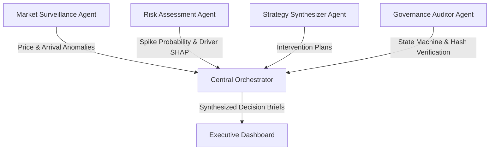

# Agentic Multi-Module Orchestration
## Autonomous Decision Systems for Commodity Market Stabilisation

### 1. Overview of Autonomous Agents

The platform incorporates specialized, role-bound autonomous agents orchestrated by a central coordinator to synthesize disparate market data into actionable interventions.

### 2. Specialized Agent Roles

1. **Market Surveillance Agent (`MarketSurveillanceAgent`)**
   - Continuously ingests streaming feeds from AGMARKNET, e-NAM, and district market committees.
   - Computes statistical z-scores on mandi modal prices and arrivals.
   - Detects cartelization, hoarding anomalies, and artificial supply bottlenecks.

2. **Risk Assessment Agent (`RiskAssessmentAgent`)**
   - Ingests quantitative forecasts and conformal prediction intervals.
   - Computes the aggregate Spike Probability metric.
   - Identifies whether surges are transitory (weather shock) or structural (acreage reduction).

3. **Strategy Synthesizer Agent (`StrategySynthesizerAgent`)**
   - Formulates concrete market intervention packages.
   - Optimizes buffer stock release quantities against warehouse proximity to demand centers.
   - Evaluates budget outlay versus consumer welfare gains.

4. **Governance Auditor Agent (`GovernanceAuditorAgent`)**
   - Validates that all proposed interventions comply with state procurement norms.
   - Enforces the state-machine authorization lifecycle.
   - Signs each transaction with SHA-256 cryptographic hashes for the immutable audit trail.
